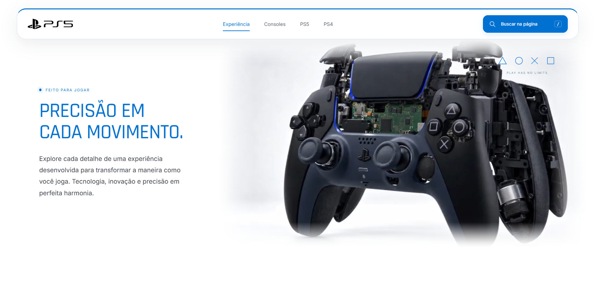
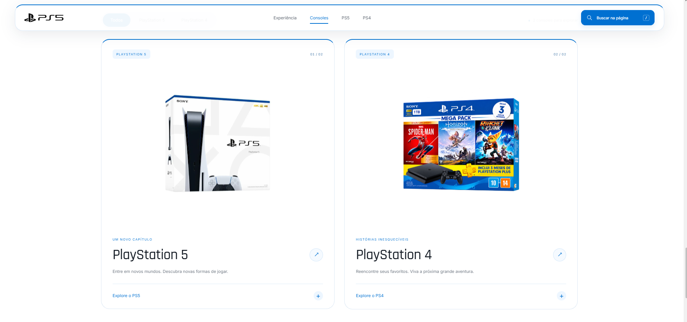

# PlayStation 5 | Interactive Website

Projeto de uma página interativa inspirada no **PlayStation 5**, desenvolvida com HTML, CSS e JavaScript, com foco em animações, responsividade e experiência do usuário.

## Preview do Projeto

## Sobre o Projeto

O site utiliza **GSAP e ScrollTrigger** para criar animações interativas, incluindo um vídeo de desmontagem do controle DualSense, controlado diretamente pelo scroll da página.

Ao rolar para baixo, o vídeo avança progressivamente. Ao rolar para cima, a animação retrocede, proporcionando uma experiência dinâmica e imersiva.

Também foram implementados um sistema de busca interativo, navegação suave, filtros para os consoles PS4 e PS5, efeitos de parallax e animações nos elementos da interface.

## Animações e Interatividade

O projeto conta com animações sincronizadas com a rolagem, transições suaves e elementos interativos, seguindo a identidade visual da PlayStation.

## Tecnologias Utilizadas

- HTML5
- CSS3
- JavaScript
- GSAP
- ScrollTrigger
- Design Responsivo

## Objetivo

Explorar técnicas modernas de desenvolvimento Front-end, combinando animações avançadas, interatividade e uma interface visualmente envolvente.

## Como Executar

Clone o repositório e abra o arquivo `index.html` no navegador ou utilize a extensão Live Server do VS Code.

---

**Projeto desenvolvido para fins de estudo e portfólio. Não possui vínculo oficial com a Sony ou PlayStation.**
